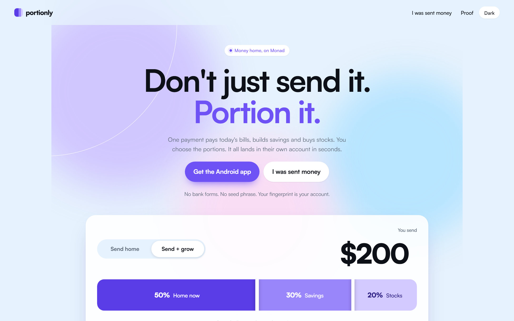
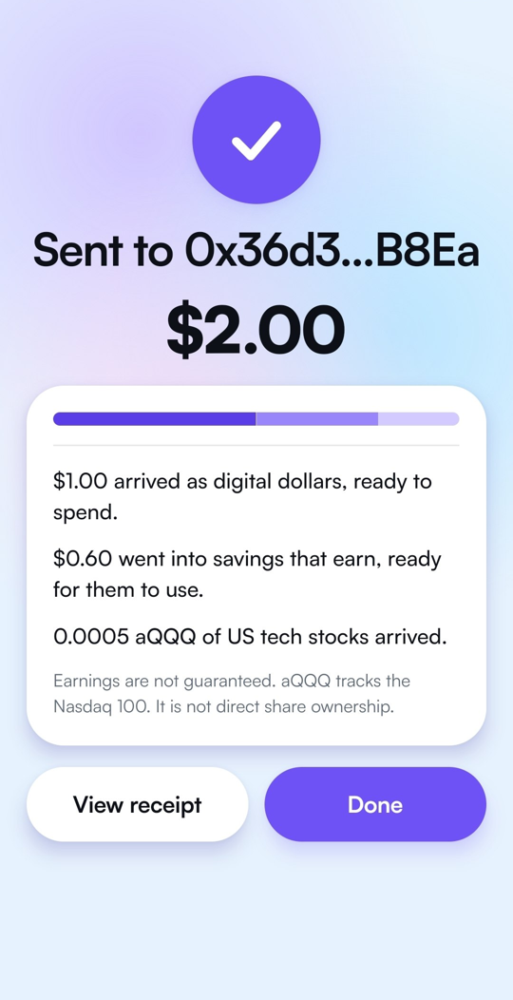
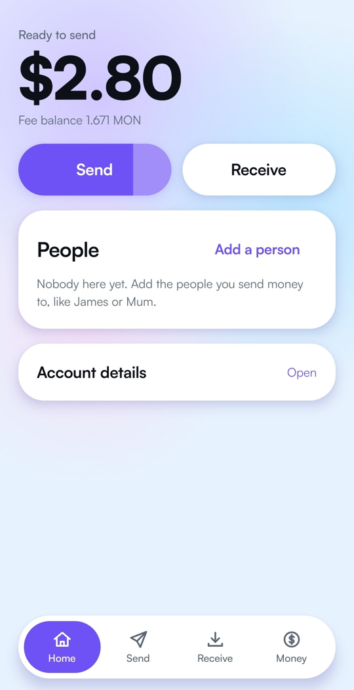

<p align="center">
  
</p>

<h1 align="center">Portionly</h1>

<p align="center">
  <b>Don't just send it. Portion it.</b><br>
  One payment pays today's bills, builds savings and buys stocks. It lands in their own account in seconds.
</p>

<p align="center">
  <a href="https://youtu.be/khrRnv4NSdM"><b>Demo video</b></a> ·
  <a href="https://portionly-three.vercel.app"><b>Live site</b></a> ·
  <a href="https://expo.dev/artifacts/eas/qXSTX_SARK0OVhWbZvjwZ5eTXJANsJ4eah6ijF-Rw-U.apk"><b>Android app</b></a> ·
  <a href="https://portionly-three.vercel.app/proof"><b>Proof</b></a> ·
  <a href="https://x.com/portionly"><b>@portionly</b></a> ·
  <a href="https://github.com/Mhidey09/portionly/actions/workflows/verify.yml"></a>
</p>

<p align="center">
  <a href="https://portionly-three.vercel.app"></a>
</p>

Built for **Monad Metropolis**, Track 02: Consumer Products & Payments. Runs on Monad mainnet with real payments; the Agora Instant Settlement flow runs on Monad testnet, as that bounty asks.

## One payment, three outcomes, one transaction

[This payment](https://monadscan.com/tx/0x3dce58f65bf4d56504f9dbb3607bc52a02298754890e6572a0e6f4dc3fa5bbf9) left a phone as 1 AUSD, signed with a fingerprint. It landed as 0.50 to spend, 0.30 in savings that earn and 0.20 in a US tech stock fund, all in a single Monad transaction. Other ways of sending money home move one amount and stop. Portionly lets the sender decide what the money becomes.

<p align="center">
  
</p>

## The problem

Money sent home gets spent the week it arrives. The sender often wants part of it kept for school fees or put to work, but a transfer only knows one job: arrive. Splitting it afterwards needs the person at the other end to open accounts, move funds and stay disciplined, and it rarely happens.

## What Portionly does

The sender decides what the money becomes before it leaves, and it all settles in one transaction on Monad.

| Portion | What the recipient gets | How |
|---|---|---|
| **Home now** | Digital dollars, ready to spend | AUSD sent straight to their account |
| **Savings that earn** | A share of a savings vault, open or locked until a date | Upshift AUSD vault, with an optional lock of 1 to 12 months |
| **US tech stocks** | A fund that follows the largest US technology companies | aQQQ, bought on Uniswap v4 with a price limit |

Need it all to arrive as cash today? **Send home** skips the split and sends every dollar as AUSD.

Two things make it work across borders, not just between wallets:

- **Send to a link.** The person at the other end needs no account, no address and no fee coin. The sender shares a link; they open it, create an account with a fingerprint and collect. The link pays its own network fee and passes on what is left.
- **Their currency.** Pick a person's currency once and every amount also shows in their money, at a live reference rate, in the app and on the page they open.

<p align="center">
  
  &nbsp;&nbsp;
  
</p>

## For judges: five minutes, no keys

| Step | What to do | What you see |
|---|---|---|
| 1 | Open [portionly-three.vercel.app](https://portionly-three.vercel.app) | Flip between Send home and Send + grow, drag the lines, pick a currency |
| 2 | Open [Proof](https://portionly-three.vercel.app/proof) | Every payment the contracts have settled, each linked to its receipt |
| 3 | Open [a real recipient's page](https://portionly-three.vercel.app/pay/0x42e0dDf73e2275e7F41B22Cf9c587ADDA3C1B7D2?cur=NGN) | What arrived, as three portions, in their currency, with locked savings |
| 4 | Install the [Android app](https://expo.dev/artifacts/eas/qXSTX_SARK0OVhWbZvjwZ5eTXJANsJ4eah6ijF-Rw-U.apk) and open it | Three intro pages, then an account made with your fingerprint. No seed phrase |
| 5 | In the app: Home, then **Instant settle** | Free test dollars from Agora's faucet, then a payment settled through Agora Instant Settlement in under a second |

Steps 1 to 3 need nothing installed. Step 5 uses Monad testnet, so it costs nothing. Sending on mainnet needs a little AUSD and MON in the account; the Receive tab shows the address to fund.

## Product flow

| Step | What happens | Where to see it |
|---|---|---|
| 1. Sign in | A fingerprint creates the account through a Mera passkey | App: first run |
| 2. Choose who | A saved person, an address or pay link, or a link for someone with no account | App: Send, step one |
| 3. Choose how | Send home, or Send + grow with draggable portions and an optional lock on the savings | App: Send, step two |
| 4. Review | Each portion in dollars and in their currency, the live stock price, the cost of the stock part | App: review screen |
| 5. Settle | One transaction routes all three portions; the app checks balances and the event before it says Sent | [A real payment](https://monadscan.com/tx/0x3dce58f65bf4d56504f9dbb3607bc52a02298754890e6572a0e6f4dc3fa5bbf9) |
| 6. Receive | The recipient sees what arrived on their page, or collects a link with a fingerprint | [Recipient page](https://portionly-three.vercel.app/pay/0x42e0dDf73e2275e7F41B22Cf9c587ADDA3C1B7D2) |
| 7. Use it | Spend it, withdraw savings, sell stocks, claim locked savings when the date passes | App: Money |

## Architecture

```
 Sender's phone                         Monad mainnet                         Recipient
 ──────────────                         ─────────────                         ─────────
 fingerprint  ──▶  Mera passkey   ──▶   PortionlySplitterV2.execute(plan)
                   account                │
                                          ├─ Home now  ──▶ AUSD ───────────────▶ their account
                                          ├─ Savings   ──▶ Upshift vault ──────▶ their account,
                                          │                                      or PortionlyFuture
                                          │                                      until the unlock date
                                          └─ Stocks    ──▶ Uniswap v4 ─────────▶ their account
                                                           (if the price moves more than 1%,
                                                            this part goes to savings instead)

 No account at the other end?
 fingerprint  ──▶  PortionlyLink.create ──▶ waits under a one time key ──▶ link ──▶ they open it,
                                                                                    make an account,
                                                                                    and the key claims:
                                                                                    same three portions

 PlanExecuted, PositionLocked, PositionClaimed  ──▶  Envio HyperIndex  ──▶  history, locked savings, proof page
```

- **One transaction.** The portions always add up to exactly what was signed. If any part fails, nothing moves.
- **Nothing held.** The contracts have no owner, no admin and no upgrade path. Assets go to the recipient, to a lock only the recipient can open, or wait under a link the sender can take back until it is collected.
- **Readable.** All four contracts are source verified on Sourcify; links are in [Deployments](docs/DEPLOYMENTS.md).
- **Checked before success.** The app compares balances before and after and reads the `PlanExecuted` event before it says "Sent".

## One fingerprint, a wallet for each person

The account is a [Mera](https://docs.monad.xyz/guides/mera) passkey: no seed phrase, no extension, no server holding keys. From that one passkey the app derives a main wallet and a separate wallet for each person the sender pays, so every relationship has its own budget and history, and a recipient sees only the wallet that pays them.

## What the recipient can do

Everything arrives in the recipient's own account. From the app they can send it on, **withdraw savings** (now for a 0.2% vault fee, or free after the vault's waiting period), **sell stocks** back to digital dollars, and **claim** locked savings once the date passes. Without the app they can still see it all on their page.

## What is real

| Part | Status | Evidence |
|---|---|---|
| Contracts on Monad mainnet | Live, bytecode checked | [Deployments](docs/DEPLOYMENTS.md) |
| Split payment from a phone, signed with a passkey | Done on mainnet | [Evidence](docs/evidence/2026-10-09-phone-mera-plan.md) |
| Send home | Done on mainnet from a phone | [Proof page](https://portionly-three.vercel.app/proof) |
| Savings locked for a month | Done on mainnet from a phone | [Proof page](https://portionly-three.vercel.app/proof) |
| Claim after the lock | Mainnet fork test; the first real lock opens 9 Nov 2026 | `contracts/test/PortionlySplitterV2Fork.t.sol` |
| Send to a link, collected with the link paying its own fee | Done on mainnet | [Evidence](docs/evidence/2026-10-10-link-payment.md) |
| One passkey, a wallet per person | Done on mainnet from a phone | [Evidence](docs/evidence/2026-10-10-many-keys.md) |
| Amounts in the recipient's currency | Live, public reference rate | App and [recipient page](https://portionly-three.vercel.app/pay/0x42e0dDf73e2275e7F41B22Cf9c587ADDA3C1B7D2?cur=NGN) |
| Sell stocks, withdraw savings now | Done on mainnet | [Evidence](docs/evidence/2026-10-10-recipient-actions.md) |
| Withdraw savings after the waiting period | Mainnet fork test | `contracts/test/UpshiftRedeemFork.t.sol` |
| A transfer settled through Agora Instant Settlement | Done on Monad testnet, from a phone | [Evidence](docs/evidence/2026-10-11-agora-instant-settlement.md) |
| Restore people, budgets and sent links on a new phone | Built; checked against the real account's chain history | `app/src/restore.ts` |
| Contract tests | 26 unit, 36 fuzz (1,024 runs each), 6 invariants (16,384 calls each), 13 mainnet fork tests | [`contracts/test/`](contracts/test) |
| Payment history and proof page | Live, from the indexer | [`indexer/`](indexer) |
| Cash out to a bank | Not built | Ramp Network sells AUSD on Monad to a bank or card. An API key for that was requested on 11 Oct 2026 |

## Why Monad

The contracts are plain EVM. The product is not portable, for four reasons.

- **One transaction does the whole job.** [The first split](https://monadscan.com/tx/0x3dce58f65bf4d56504f9dbb3607bc52a02298754890e6572a0e6f4dc3fa5bbf9) used about one million gas: two Uniswap v4 swaps, a vault deposit, a lock and a transfer, 20 events. It cost about a tenth of a MON. On a slower or dearer chain a one dollar payment could not afford to be split three ways, and the split is the product.
- **It settles while the sender is still looking at the screen.** The app waits for the transaction, checks balances and the event, and only then says Sent. The phone measured 1.2 seconds from confirm to arrived for the Agora settlement.
- **The account is Mera.** A fingerprint is the whole sign up, and the same passkey gives each person their own budget wallet. That is Monad's passkey stack, not a wallet bolted on.
- **Every part is live here.** AUSD is native on Monad, Agora's Instant Settlement pair runs on Monad testnet, the stock fund trades against AUSD on Monad through Uniswap v4, the savings vault takes AUSD on Monad, and Envio indexes it.

## Built on

| | Used for |
|---|---|
| **Monad** | One transaction settles all three portions in about a second |
| **Mera** | The whole account layer: a fingerprint creates the account and every wallet in it |
| **AUSD (Agora)** | The dollars that move. Instant settle runs a transfer through Agora's Instant Settlement pair on testnet, and the app reads Agora's public metrics API |
| **Upshift** | The savings vault |
| **Anchored aQQQ on Uniswap v4** | The stock portion |
| **Envio HyperIndex** | Payment history, locked savings and the public proof page |

## Honest limitations

- **Android test release.** Installed from an APK, not a store.
- **No bank cash out yet.** Recipients receive digital dollars, shown in their own currency. Access to a licensed off ramp for AUSD on Monad was requested on 11 Oct 2026.
- **Fees are paid in MON.** A payment sent by link carries its own fee. Someone paid straight to an address needs a little MON before moving the money on.
- **Savings and stocks carry real risk.** Earnings are not guaranteed, the stock fund moves with the market and costs about 0.9% to buy or sell, and an instant savings withdrawal depends on the vault having cash on hand. The app shows each of these before you commit.
- **Unaudited.** The contracts are source verified and covered by unit, fuzz, invariant and mainnet fork tests, but have had no professional audit. Test amounts were small on purpose.

The fine print is in [SECURITY.md](SECURITY.md).

## Layout

| Folder | What is in it |
|---|---|
| [`contracts/`](contracts) | Foundry contracts (splitter, stock executor, lock, link), deploy scripts, unit and Monad fork tests |
| [`app/`](app) | Android app (Expo, React Native, Mera) |
| [`dashboard/`](dashboard) | The site: landing page, recipient page, proof page |
| [`indexer/`](indexer) | Envio HyperIndex config, schema and handlers |
| [`docs/`](docs) | Product brief, deployments, build log and evidence |

## Quick start

```sh
# contracts: unit tests, then the same suite against Monad mainnet
cd contracts && forge test && forge test --fork-url https://rpc.monad.xyz

# app: tests and types
cd app && npm ci && npm test && npm run typecheck

# site: tests, then run it
cd dashboard && npm ci && npm test && npm run dev
```

Building the Android app needs `MERA_RP_ID` set to the site that serves `/.well-known/assetlinks.json` for your signing key. See [`app/README.md`](app/README.md).

## Credits

External code: OpenZeppelin Contracts, forge-std, viem, Expo and React Native, the Mera SDK, Envio HyperIndex, react-native-svg and react-native-qrcode-svg. The Satoshi typeface is used under the ITF Free Font License. Every contract in `contracts/src` was written for this hackathon.

AI coding assistants were used for parts of the code, tests and documentation. Every change was reviewed and tested, and every mainnet transaction was signed with the author's keys.

## License

MIT. See [LICENSE](LICENSE). To report a security problem, see [SECURITY.md](SECURITY.md).
